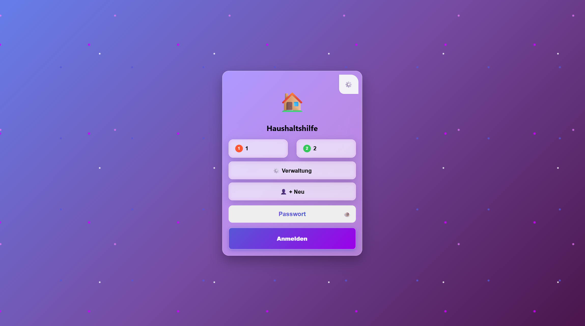
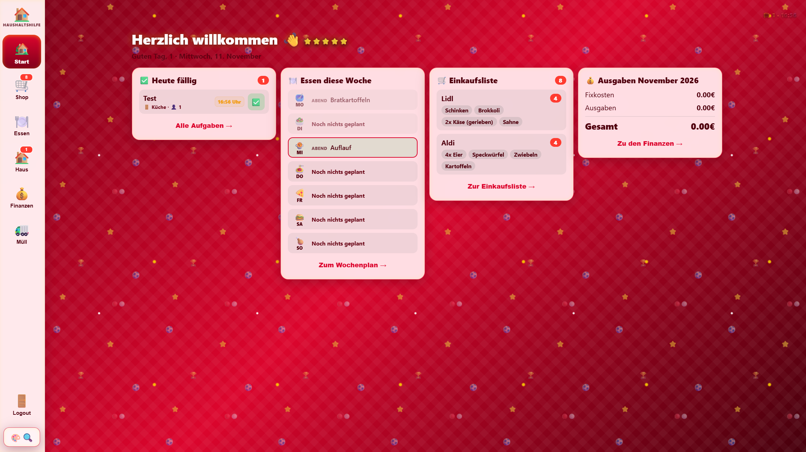
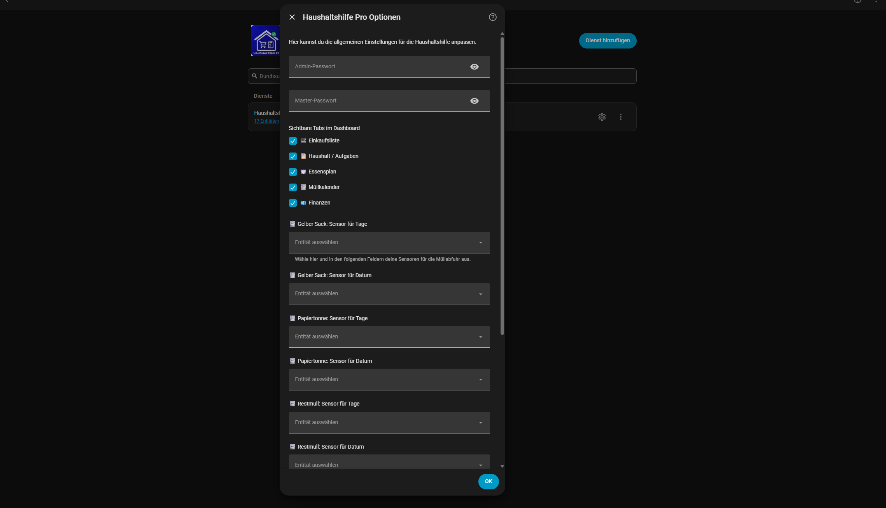
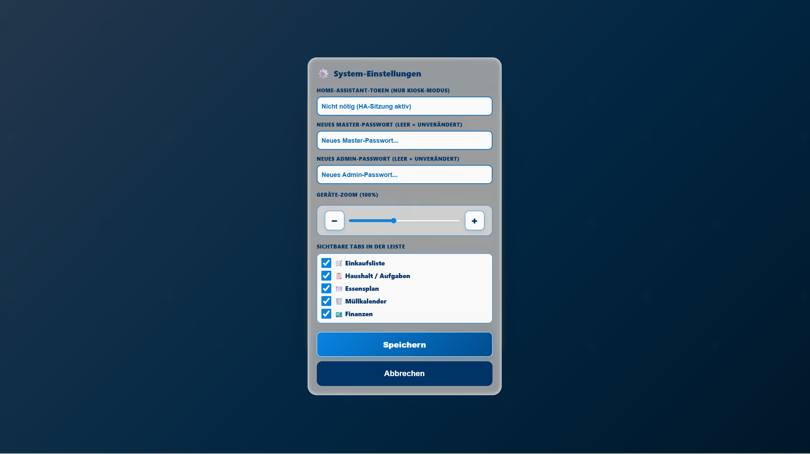
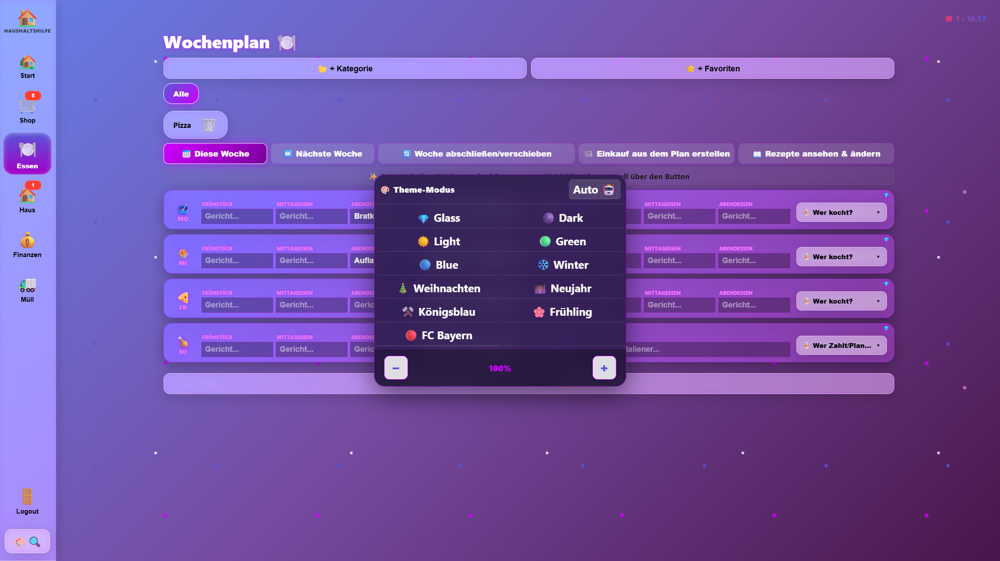
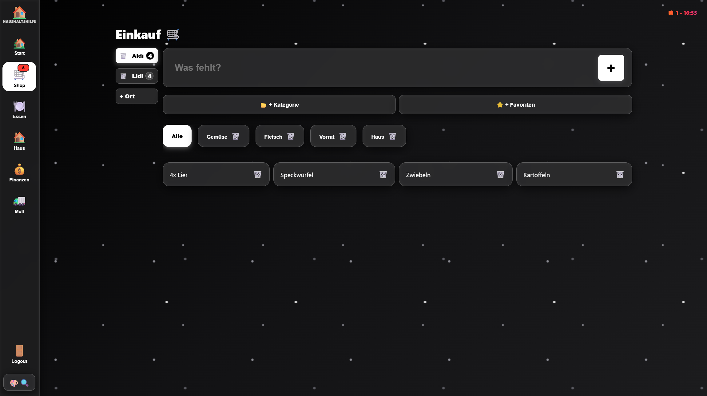
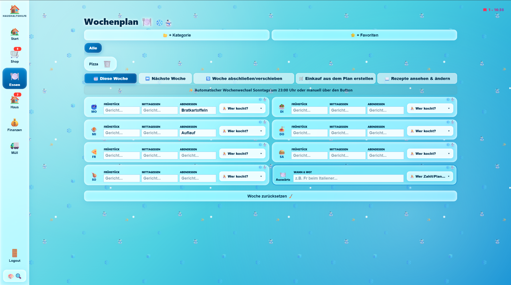
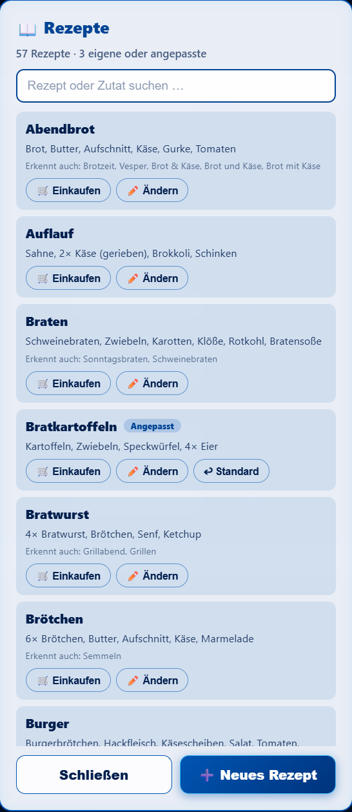
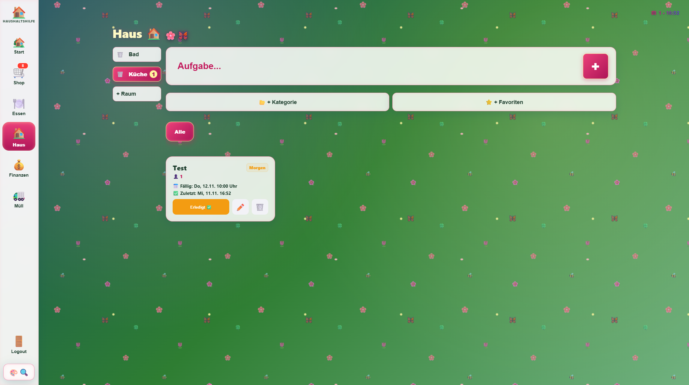
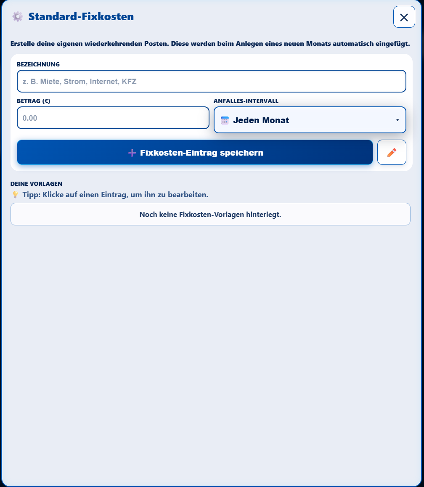

# 🏠 Haushaltshilfe Pro für Home Assistant

Eine elegante, benutzerfreundliche All-in-One-Lösung für die Organisation deines Haushalts direkt in Home Assistant. Verwalte Einkaufslisten, Finanzen, Aufgaben, Essenspläne und Müllabfuhr-Termine in einem übersichtlichen Custom Panel.

---

## ✨ Features

- 🏡 **Startseite**: Begrüßung mit allem Wichtigen auf einen Blick – heute fällige Aufgaben, Einkaufsliste, aktuelle Ausgaben und das Essen der aktuellen Woche.
- 🍽️ **Wochen-Essensplan**: Speiseplan von Montag bis Sonntag übersichtlich verwalten, für diese Woche und für die nächste Woche.
- 👆 **Schnelle Mahlzeiten-Auswahl**: Ein Tipp auf ein Essensfeld öffnet ein Auswahlfenster mit deinen Favoriten und Rezepten – oder du tippst einfach etwas ein.
- 🛒 **Automatische Einkaufsliste aus dem Essensplan**: Trägst du ein bekanntes Gericht ein (z. B. *Pizza*), setzt die App auf Wunsch die Zutaten automatisch auf die Einkaufsliste – in den Laden deiner Wahl. Automatisch, händisch oder gar nicht: Du entscheidest.
- 📖 **Rezepte**: Über 50 eingebaute Rezepte, die du ansehen, ändern und um eigene Rezepte erweitern kannst.
- 🗑️ **Müllabfuhr-Übersicht**: Direkte Anbindung an bestehende Müll-Sensoren, die du ganz bequem in den Integrations-Optionen von Home Assistant auswählst.
- 🔄 **Neustart-sicher**: Alle Daten (Finanzen, Einkäufe, Aufgaben, Essenspläne, Rezepte) bleiben auch nach einem Home Assistant Neustart dauerhaft gespeichert.
- 🔑 **Sichere Anmeldung**: Läuft über deine Home-Assistant-Sitzung. Für Wand-Tablets im Kiosk-Modus kann pro Gerät ein eigenes Token hinterlegt werden.
- 🎛️ **Dynamische Tab-Steuerung**: Blende einzelne Navigations-Tabs ganz nach Bedarf aus oder ein – entweder direkt im Dashboard-Overlay oder über die Home Assistant Integrations-Einstellungen.
- 🔐 **Passwort- & System-Verwaltung**: Master- und Admin-Passwort bequem über die Benutzeroberfläche oder in Home Assistant anpassen. Alle Passwörter werden nur gehasht gespeichert und am Server geprüft.
- 🔄 **Vollständige bidirektionale Synchronisation**: Egal ob du Passwörter oder die Tab-Sichtbarkeit im Dashboard-Overlay oder in den HA-Integrationsoptionen änderst – beide Stellen halten sich automatisch gegenseitig synchron!
- 📱 **Für Handy, Tablet und PC**: Die Oberfläche passt sich der Bildschirmgröße und dem eingestellten Zoom an. Kleine Fenster bleiben klein, große Fenster bleiben groß – auch im Wand-Tablet-Betrieb.
- 🎨 **11 Themes**: Von Glass und Dark bis Weihnachten und FC Bayern. Alle Fenster – auch die neuen für Essensauswahl, Zutaten und Rezepte – passen sich dem gewählten Theme an.

### 💰 Finanzen & Fixkosten-Vorlagen

* Monatsübersicht für Ausgaben und Fixkosten.
* Vorlagen-Verwaltung mit flexiblen Intervallen (monatlich, quartalsweise, jährlich) für die automatische Übernahme in neue Monate.
* Geräteübergreifende Synchronisation via Home Assistant Helper (`helper_finance_templates`).

### 🔔 Home Assistant Automatisierungen & Push-Benachrichtigungen

* **Aufgaben-Bestätigung:** Push-Nachricht bei Erledigung/Bearbeitung einer Aufgabe mit Raum- und Namenangabe.
* **Fälligkeits-Erinnerung:** Minuten-genaue Push-Erinnerung, wenn eine Aufgabe fällig wird.
* Die fertigen YAML-Vorlagen dafür findest du im Ordner [`automations/`](automations/).

---

# 🚀 Installation & Einrichtung

### 1. Installation über HACS (empfohlen)

1. Öffne **HACS** in deiner Home Assistant Instanz.
2. Suche nach **Haushaltshilfe** (die Integration ist direkt im offiziellen HACS-Default-Store verfügbar).
3. Klicke auf **Herunterladen**.
4. Starte deine Home Assistant Instanz einmal neu, damit die Integration geladen wird.

*(Falls du die Integration früher manuell installiert hattest, lösche bitte vorab den alten Ordner `custom_components/haushaltshilfe` aus deinem Home Assistant Verzeichnis, bevor du sie über HACS installierst.)*

### 2. Integration aktivieren

1. Gehe in Home Assistant zu **Einstellungen** ➔ **Geräte & Dienste**.
2. Klicke unten rechts auf **Integration hinzufügen**.
3. Suche nach **Haushaltshilfe Pro** und füge die Integration hinzu.
4. Starte Home Assistant einmal neu, damit das Seitenleisten-Panel geladen wird.

> **Hinweis:** Es müssen **keine** Einträge in der `configuration.yaml` gemacht und **keine** Helfer manuell angelegt werden. Alle Speicher-Sensoren werden von der Integration automatisch generiert und verwaltet!

---

## 📱 Erstanmeldung & Geräte-Einrichtung

Wenn du die **Haushaltshilfe Pro** zum ersten Mal auf einem neuen Gerät (Smartphone, Tablet, Wand-Display oder PC) öffnest, richtest du die Verbindung einmalig ein.

### 1. Aufrufen über die Home-Assistant-Seitenleiste (empfohlen, auch in der Companion-App)

Öffne einfach deine Home-Assistant-Oberfläche und klicke in der Seitenleiste auf den Eintrag **Haushaltshilfe** (bzw. **Haushaltshilfe Pro**).

- Die Verbindung zum Server und die Authentifizierung laufen komplett im Hintergrund über deine bestehende Home-Assistant-Sitzung und den integrierten Proxy.
- Bei dieser Nutzung ist kein manuelles Long-Lived Access Token auf den Geräten nötig – es ist nichts weiter einzurichten.

### 2. Benutzer auswählen & einrichten

- Beim ersten Start legst du über **👤 + Neu** die Benutzer an (dafür wird das Admin-Passwort abgefragt) oder wählst deinen bestehenden Benutzer aus.
- Über das Zahnrad-Icon **⚙️** kannst du in den System-Einstellungen jederzeit deine Passwörter und Konfigurationen verwalten.

---

## 🌐 Direktaufruf über den Webbrowser (URL / Kiosk / Wand-Tablet)

Du kannst das Panel der Haushaltshilfe Pro auf zwei Arten aufrufen:

1. **Über die Seitenleiste:** Klicke einfach auf den Menüeintrag **Haushaltshilfe** in deinem Home Assistant.
2. **Direkt per Browser-URL:** Rufe die Adresse direkt auf, z. B. auf einem Wand-Tablet oder im Kiosk-Browser:
   - `http://<DEINE-HOME-ASSISTANT-IP>:8123/haushaltshilfe_static/index.html`
   - `http://<DEINE-HOME-ASSISTANT-IP>/haushaltshilfe_static/index.html`

### Token-Einrichtung für den Direktaufruf

Beim Direktaufruf über die Browser-URL gibt es im Hintergrund keine aktive Home-Assistant-Sitzung. Deshalb braucht das Gerät einmalig ein eigenes Token:

1. In Home Assistant unten links auf dein **Profil** ➔ **Sicherheit** ➔ **Langlebige Zugangstoken** ➔ **Token erstellen** klicken (z. B. *Tablet Küche*). Am besten erstellst du dieses Token mit einem eigenen HA-Benutzer ohne Admin-Rechte.
2. In der Haushaltshilfe auf das Zahnrad **⚙️** tippen, das Token in das Feld **Home-Assistant-Token** einfügen und speichern.

Das Token wird nur im Browser dieses Geräts gespeichert und nie an andere Geräte weitergegeben. Geht das Tablet verloren, widerrufst du einfach dieses eine Token.

> 🔒 **Update-Hinweis für Versionen bis 1.0.6:** Ältere Versionen haben ein Token im Backend gespeichert und ohne Anmeldung herausgegeben. Bitte nach dem Update **alle Langlebigen Zugangstoken widerrufen**, die du für die Haushaltshilfe erstellt hast, und für Kiosk-Geräte neue anlegen.

---

## 🗑️ Müllabfuhr konfigurieren (optional)

Solltest du bereits eine Müllkalender-Integration (wie z. B. *Waste Collection Schedule* über HACS) nutzen, kannst du deine Sensoren ganz bequem und **update-sicher** direkt in der Home Assistant Oberfläche hinterlegen – ganz ohne Dateien bearbeiten zu müssen.

1. Gehe in Home Assistant auf **Einstellungen** ⚙️ ➔ **Geräte & Dienste**.
2. Suche die Integration **Haushaltshilfe Pro** und klicke auf **Konfigurieren**.
3. Wähle im unteren Bereich einfach deine bestehenden Sensoren für **Gelber Sack**, **Papiertonne** und **Restmüll** (jeweils den Sensor für die *verbleibenden Tage* und das *Abholdatum*) aus der Liste aus.
4. Klicke auf **OK** – das Dashboard übernimmt deine Auswahl sofort automatisch und behält sie auch bei zukünftigen HACS-Updates dauerhaft bei!

---

# 📖 Bedienungsanleitung – Haushaltshilfe Pro 🏠

## 🔑 Übersicht der Standard-Passwörter & Einstellungen

| Funktion / Rolle | Standard-Passwort | Beschreibung / Einsatzort |
| :--- | :--- | :--- |
| **Master-Passwort** | `Dein_Passwort_welches_du_vergeben_hast` | Zugriff auf die System-Einstellungen (`⚙️` oben rechts am Login-Bildschirm). |
| **Admin-Passwort** | `Dein_Passwort_welches_du_vergeben_hast` | Zugriff auf die Benutzerverwaltung (`⚙️ Verwaltung` zum Löschen von Benutzern). |

> 💡 **Hinweis zu Passwörtern & Tabs:** Sämtliche Passwörter sowie die Sichtbarkeit der einzelnen Tabs können flexibel auf zwei Wegen angepasst werden:
> 1. **Über das Dashboard**: Im Login-Bildschirm oben rechts auf das Zahnrad `⚙️` klicken.
> 2. **Über Home Assistant**: Unter **Einstellungen ➔ Geräte & Dienste ➔ Haushaltshilfe Pro ➔ Konfigurieren**.
>
> Beide Einstellungen halten sich vollständig automatisch in beide Richtungen synchron!

---

## 1. 🔑 Anmelden & Benutzerverwaltung (`loginOverlay`)

### Anmelden
1. Klicke im Login-Bildschirm auf deinen **Benutzer-Avatar** im Raster (`userGrid`).
2. Gib dein Passwort in das Eingabefeld ein (über das **👁️-Symbol** kannst du die Eingabe sichtbar machen).
3. Klicke auf **Anmelden**.

---

### Neuer Benutzer erstellen (`👤 + Neu`)
1. Klicke auf dem Login-Bildschirm auf den Button **`👤 + Neu`**.
2. **Wichtig:** Ein neuer Benutzer wird direkt mit Eingabe von Benutzername und persönlichem Passwort angelegt.
3. Bestätige die Abfragen mit **OK**.
4. Der Benutzer erscheint sofort als auswählbare Karte im Login-Grid.

---

### Benutzer verwalten & löschen (`⚙️ Verwaltung`)
1. Klicke auf **`⚙️ Verwaltung`**.
2. Gib das **Admin-Passwort** ein.
3. An allen Benutzerkarten erscheint nun ein rotes **`✕`** zum Löschen.
4. Klicke auf **`❌ Beenden`**, um den Verwaltungsmodus wieder zu verlassen.

---

### System-Einstellungen (`⚙️` oben rechts)
1. Klicke oben rechts auf der Login-Karte auf das graue Zahnrad **`⚙️`**.
2. Gib das **Master-Passwort** ein.
3. Im Dialog **System-Einstellungen** (`settingsOverlay`) kannst du:
   - Das **Home-Assistant-Token** eintragen (nur für den Kiosk-Modus nötig – bei aktiver HA-Sitzung steht dort *„Nicht nötig“*).
   - Das **Master-Passwort** für die Systemeinstellung neu festlegen (leer lassen = unverändert).
   - Das **Admin-Passwort** für die Benutzerverwaltung neu festlegen (leer lassen = unverändert).
   - Den **Geräte-Zoom** per Schieberegler oder mit **−** / **+** einstellen. Der Zoom gilt nur für das Gerät, auf dem du ihn änderst.
   - Die **sichtbaren Tabs** in der Leiste auswählen.
4. Klicke auf **Speichern**.

---

## 🎛️ Tab-Sichtbarkeit anpassen

Die Navigations-Tabs 🛒 Einkaufsliste, 📋 Haushalt / Aufgaben, 🍽️ Essensplan, 🗑️ Müllkalender und 💶 Finanzen können flexibel auf zwei Wegen ein- oder ausgeblendet werden. Die 🏡 Startseite ist immer sichtbar.

1. **Über das Dashboard**:
   - Klicke auf der Anmeldeseite oben rechts auf das Zahnrad **`⚙️`**.
   - Gib das Master-Passwort ein und passe die Häkchen im Bereich **„Sichtbare Tabs in der Leiste“** an.
2. **Über Home Assistant**:
   - Gehe zu **Einstellungen ➔ Geräte & Dienste ➔ Haushaltshilfe Pro ➔ Konfigurieren**.
   - Wähle dort die gewünschten Tabs in der Mehrfachauswahl aus.

> 💡 **Hinweis:** Beide Wege halten sich vollständig automatisch in beide Richtungen synchron!

---

## 2. 🏡 Startseite

Nach der Anmeldung siehst du auf einen Blick, was heute wichtig ist:

- **Begrüßung** mit deinem Namen und dem heutigen Datum.
- **Heute fällig**: Die Aufgaben, die heute dran sind. Mit einem Tipp auf das Häkchen erledigst du sie direkt.
- **Essen diese Woche**: Der Wochenplan von Montag bis Sonntag, der heutige Tag ist hervorgehoben.
- **Einkaufsliste**: Die fehlenden Artikel, nach Läden gruppiert.
- **Ausgaben des Monats**: Fixkosten, Ausgaben und Gesamtsumme des aktuellen Monats.

Unter jeder Karte führt ein Link direkt ins passende Modul (*Alle Aufgaben*, *Zum Wochenplan*, *Zur Einkaufsliste*, *Zu den Finanzen*).

---

## 3. 🛒 Einkaufs-Modul (`Shop` / `v-shop`)

- **Artikel hinzufügen**: Gib den Namen im Feld *„Was fehlt?“* ein und klicke auf **`+`**.
- **Schnellartikel / Favoriten**: Beim Klick auf ein Favoriten-Icon öffnet sich das Mengen-Modal (`shopQtyModal`), in dem du die gewünschte Stückzahl festlegst.
- **Kategorie & Favorit erstellen**: Nutze die Buttons **`📂 + Kategorie`** und **`⭐️ + Favoriten`**, um Schnellauswahlen anzulegen.
- **Geschäfte-Filter**: Filtere über die linke Seitenleiste (`shopSidebar`) nach Supermärkten. Mit **`+ Ort`** legst du einen neuen Laden an.
- **Zutaten aus dem Essensplan**: Artikel, die aus Rezepten kommen, landen wie alle anderen Artikel auf der Liste – mit Menge und Laden (z. B. `2x Milch @Aldi`). Mehr dazu im Kapitel *Wochenplan*.

---

## 4. 🍽️ Wochenplan-Modul (`Essen` / `v-food`)

### Grundfunktionen

- **2-Wochen-Planung (Diese Woche / Nächste Woche)**: Nutze den Wochen-Umschalter oben, um nahtlos zwischen dem Speiseplan für **Diese Woche** und **Nächste Woche** zu wechseln.
- **Mahlzeiten eintragen**: Trage in den Feldern des jeweiligen Wochentags (MO–SO) separat für Frühstück, Mittagessen und Abendessen ein, was es gibt.
- **Koch / Verantwortlichen zuweisen**: Wähle im Dropdown-Menü neben dem Tag die kochende Person aus.
- **Kategorien & Favoriten**: Nutze **`📂 + Kategorie`** und **`⭐️ + Favoriten`**, um Lieblingsgerichte schnell in den Wochenplan einzufügen.
- **Woche verschieben / abschließen**: Klicke auf **`Woche abschließen/verschieben 🔄`**, um die Gerichte von „Nächste Woche“ manuell nach vorne in „Diese Woche“ zu rücken und die nächste Woche zu leeren.
- **Automatischer Wochenwechsel**: Der Essensplan rückt jeden Sonntag um 23:00 Uhr automatisch weiter, sodass die nächste Woche nahtlos in die aktuelle Woche übergeht.
- **Woche zurücksetzen**: Klicke unten auf **`Woche zurücksetzen 🧹`**, um alle Tage der aktiven Woche auf einmal zu leeren.

### 👆 Mahlzeiten-Auswahl (Tipp auf ein Essensfeld)

Tippst du auf ein Frühstücks-, Mittags- oder Abendessen-Feld, geht es so weiter:

1. **Zuerst die Frage:** *„Möchtest du etwas aus deinen Favoriten nehmen?“* – mit den Antworten **⭐ Ja, aus Favoriten**, **📖 Nein, Rezepte & eintippen** und **Abbrechen**. Hast du noch keine Favoriten, entfällt die Frage.
2. **Das Auswahlfenster:**
   - Oben kannst du suchen oder selbst etwas eintippen und mit **✓ Übernehmen** (oder Enter) bestätigen.
   - Darunter wechselst du zwischen **⭐ Favoriten** (mit deinen Kategorien) und **📖 Rezepten**.
   - Ein Tipp auf ein Gericht trägt es direkt ein und speichert es.
   - **🗑️ Leeren** löscht den Eintrag.
3. **Meine Wahl merken:** Mit diesem Haken fragt die App künftig nicht mehr nach den Favoriten.
4. **Verhalten umstellen:** Unten im Auswahlfenster legst du unter **„Beim Antippen eines Feldes“** fest, was passieren soll:
   - *Erst nach Favoriten fragen*
   - *Gleich Favoriten zeigen*
   - *Gleich Rezepte & Eintippen*
   - *Nur normal eintippen* (wie früher, direkt mit der Tastatur)

> 💡 Das Feld **„außer Haus“** (Sonntag) bleibt immer direkt tippbar. Die Einstellung zum Antippen gilt nur für das Gerät, auf dem du sie wählst.

### 🛒 Zutaten automatisch auf die Einkaufsliste

Trägst du ein Gericht ein, das die App kennt (eingebaut oder von dir gespeichert), fragt sie nach den Zutaten:

- **⚡ Automatisch auf die Liste**: Alle fehlenden Zutaten werden direkt auf die Einkaufsliste gesetzt.
- **✋ Händisch auswählen**: Du siehst eine Liste, hakst Zutaten ab und änderst die Menge mit **＋ / −**. Weitere Zutaten kannst du unten ergänzen.
- **Nein danke**: Es passiert nichts.

Weitere Details:

- **In welchen Laden?** Bei der Frage wählst du den Laden aus. Vorausgewählt ist der Laden, den du zuletzt benutzt hast. Gibt es nur einen Laden, entfällt die Auswahl.
- **Keine Doppelten**: Was schon auf der Einkaufsliste steht, wird nicht noch einmal hinzugefügt.
- **Meine Wahl merken**: Mit dem Haken wird die Antwort für alle künftigen Gerichte übernommen. Bei *Automatisch* wird dann immer der zuletzt benutzte Laden genommen.
- **Verhalten umstellen**: Im Zutaten-Fenster steht unter **„Beim Eintragen eines Gerichts“**: *Immer fragen*, *Automatisch hinzufügen*, *Händisch auswählen* oder *Nichts vorschlagen*.
- **🛒 Einkauf aus dem Plan erstellen**: Der Button über dem Wochenplan sammelt die Zutaten aller Gerichte der angezeigten Woche in einem Fenster.
- **Gerichte & Rezepte im Zutaten-Fenster**: Tippe auf ein Gericht, um dessen Zutaten zu ändern oder – bei unbekannten Gerichten – die Zutaten für das nächste Mal zu merken.

### 📖 Rezepte ansehen & ändern

Über **📖 Rezepte ansehen & ändern** öffnest du die Rezepte-Übersicht:

- **Suchen** nach Rezeptname oder Zutat.
- **🛒 Einkaufen**: Die Zutaten des Rezepts auf die Einkaufsliste setzen.
- **✏️ Ändern**: Zutaten und Namen anpassen. Eingebaute Rezepte kannst du ebenfalls ändern – dein eigenes Rezept ersetzt dann das eingebaute.
- **↩︎ Standard**: Setzt ein geändertes eingebautes Rezept auf den Originalzustand zurück.
- **🗑️ Löschen**: Entfernt eines deiner eigenen Rezepte.
- **➕ Neues Rezept**: Legt ein eigenes Rezept an.
- **Angepasst**: Dieses Kennzeichen zeigt dir, dass du ein eingebautes Rezept geändert hast. Oben siehst du, wie viele Rezepte es gibt und wie viele davon eigene oder angepasste sind.
- **Erkennt auch**: Unter manchen Rezepten stehen weitere Namen, unter denen es ebenfalls erkannt wird (z. B. *Grillen* für Bratwurst).

> 💡 **Zutaten eingeben:** Trenne die Zutaten mit Kommas. Mengen kannst du davor schreiben oder mit `*` dahinter, z. B. `Milch, 2 Zwiebeln, Käse*2, 500 g Mehl`.

---

## 5. 🏠 Aufgaben- & Haus-Modul (`Haus` / `v-todo`)

### Neue Aufgabe anlegen (`intervalModal`)
1. Gib die Aufgabe im Textfeld ein (z. B. *„Rasen mähen“*) und klicke auf **`+`**.
2. Im Popup kannst du festlegen:
   - **Zugeordnet an**: Wähle das zuständige Familienmitglied im Dropdown aus.
   - **Option 1 (Intervall)**: Zahl eingeben und als **Stunden**, **Minuten** oder **Tage** speichern (inkl. Standard-Uhrzeit).
   - **Option 2 (Wochentage)**: Klicke die Wochentags-Punkte an (M, D, M, D, F, S, S) und klicke auf **Tage Speichern**.
   - **Option 3 (Festes Datum)**: Exaktes Fälligkeitsdatum über den Kalender auswählen und mit **Datum nutzen ✅** bestätigen.

### Aufgabe erledigen & bearbeiten (`editModal`)
- **Erledigen**: Klicke auf das Häkchen neben der Aufgabe.
- **Bearbeiten**: Klicke auf den Namen einer Aufgabe, um das Bearbeiten-Modal zu öffnen. Hier kannst du den Namen, die Zuordnung, Intervalle, Wochentage oder das Datum anpassen.

---

## 6. 💰 Finanz-Modul (`Finanzen` / `v-finance`)

- Das Finanz-Modul ist in eine übersichtliche Zwei-Ebenen-Struktur (Jahre ➔ Monate) unterteilt.
- **Jahr anlegen**: Klicke oben auf `➕ Jahr hinzufügen` und gib eine vierstellige Jahreszahl ein (z. B. 2026), um das Jahr als neue Übersichtskarte zu erstellen.
- **Jahr öffnen**: Klicke auf eine Jahreskarte, um in die Monatsansicht des jeweiligen Jahres zu wechseln. (Über das Mülleimer-Icon `🗑️` auf der Jahreskarte lässt sich das gesamte Jahr inklusive aller Monate löschen.)
- **Monat anlegen**: Klicke im geöffneten Jahr auf `➕ Monat in diesem Jahr hinzufügen` (z. B. Oktober). Hinterlegte Fixkosten-Vorlagen werden dabei automatisch für diesen Monat übernommen.
- **Einträge verwalten**: Klicke auf eine Monatskarte, um das Detail-Modal (`finance-modal`) zu öffnen.
- **Fixum & Spendings**: Trage Fixkosten (Miete, Internet) oder variable Ausgaben (Einkauf, Tanken) mit Betrag (€) und Beschreibung ein.
- **Eintrag löschen**: Klicke auf das `✕` neben dem jeweiligen Eintrag.
- **Standard-Fixkosten-Vorlagen verwalten**: Über die Einstellungen kannst du wiederkehrende Posten (inklusive Intervall-Auswahl wie monatlich, quartalsweise oder in bestimmten Monaten) hinterlegen.
  - **Bearbeiten leicht gemacht**: Klicke einfach direkt auf einen bestehenden Fixkosten-Eintrag in der Liste, um ihn sofort in die Eingabefelder zu laden, anzupassen und per `💾 Änderung speichern` zu aktualisieren.

---

## 7. 🚛 Müll-Modul (`Müll` / `v-trash`)

- Zeigt automatisch die nächsten Abholtermine für **Gelber Sack**, **Altpapier**, **Restmüll**, **Biomüll** und die **Weihnachtsbaum-Abholung** an.
- Die Daten werden automatisch live aus den hinterlegten Home-Assistant-Sensoren geladen.

---

## 8. 🎨 Themes & Design anpassen (`theme-dropdown`)

Klicke unten links in der Seitenleiste auf das Symbol **`🎨🔍`**, um das Erscheinungsbild der Oberfläche zu wechseln und den Zoom anzupassen. Mit dem **Theme-Modus** stellst du ein, ob das Theme automatisch passend zur Jahreszeit wechselt (*Auto*) oder dein gewähltes Theme bleibt. Verfügbare Themes:

- 💎 **Glass** (Glassmorphism-Look)
- 🌑 **Dark** (Dunkler Modus)
- ☀️ **Light** (Helles Design)
- 🟢 **Green** (Grüne Akzente)
- 🔵 **Blue** (Blaue Akzente)
- ❄️ **Winter** (Winter-Design)
- 🎄 **Weihnachten** (Mit festlichen Dekorationen)
- 🎆 **Neujahr** (Silvester- & Neujahrs-Look)
- ⚒️ **Königsblau** (Schalke-Design)
- 🌸 **Frühling** (Frühlingshaftes Design)
- 🔴 **FC Bayern** (Mit roten Fußball-Akzenten)

Alle Fenster der App – auch die Fenster für Essensauswahl, Zutaten und Rezepte – übernehmen automatisch die Farben des gewählten Themes. Die Oberfläche passt sich dabei Handy, Tablet und PC sowie dem eingestellten Zoom an.

### 🛠️ Für Theme-Entwickler

Jede Theme-Datei (`<name>-theme.css`) enthält am Ende einen Block **„ESSENSWAHL, ZUTATEN & REZEPTE“**. Dort legen `--hh-*`-Variablen die Farben der neuen Fenster fest, zum Beispiel:

| Variable | Wirkung |
| :--- | :--- |
| `--hh-card-bg`, `--hh-card-border` | Hintergrund und Rahmen der Fenster |
| `--hh-text`, `--hh-head` | Schrift- und Überschriftsfarbe |
| `--hh-btn-bg`, `--hh-btn-fg`, `--hh-btn-border` | Hauptknopf (z. B. *Auf die Liste*) |
| `--hh-sec-bg`, `--hh-sec-fg`, `--hh-sec-border` | Nebenknöpfe (z. B. *Abbrechen*) |
| `--hh-field-bg`, `--hh-field-fg`, `--hh-field-border` | Eingabe- und Auswahlfelder |
| `--hh-chip-line`, `--hh-chip-on-bg` | Chips, Reiter und aktive Auswahl |
| `--hh-toast-bg`, `--hh-toast-fg` | Hinweis-Meldung unten |

Ein neues Theme braucht nur diesen Block, damit die Fenster passen. Ohne ihn gilt ein neutrales Standard-Aussehen.

---

## 🚪 Abmelden (`Logout`)

Klicke in der untersten Navigationsleiste auf das Tür-Symbol **`🚪 Logout`**, um zur Benutzerauswahl zurückzukehren.

---

## Screenshots

### 🔑 Anmeldung

### 🏡 Startseite

### ⚙️ Einstellungen

### 🎨 Themes & Zoom

### 🛒 Einkauf

### 🍲 Essensplan, Zutaten & Rezepte

 

### ✅ Aufgaben

### 💶 Finanzen

